## Diagrama de Classes

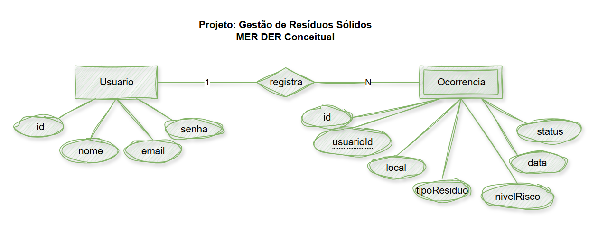

## Funcionalidades

- RF001: CRUD de usuários.
- RF002: Login.
- RF003: CRUD de ocorrências de resíduos.
- RF004: Contagem total de ocorrências tratadas.

## Prints dos Testes

### Cadastro de usuário

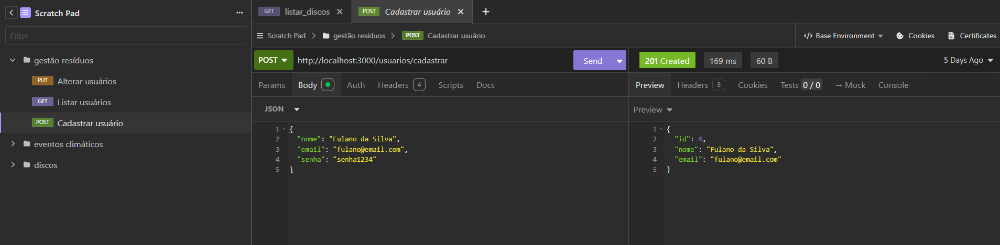

### Listagem de usuários

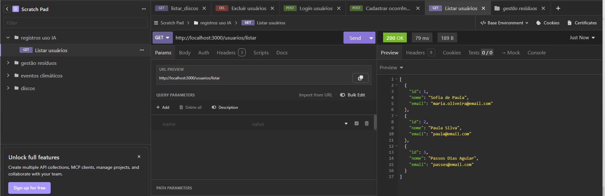

### Alteração de usuário

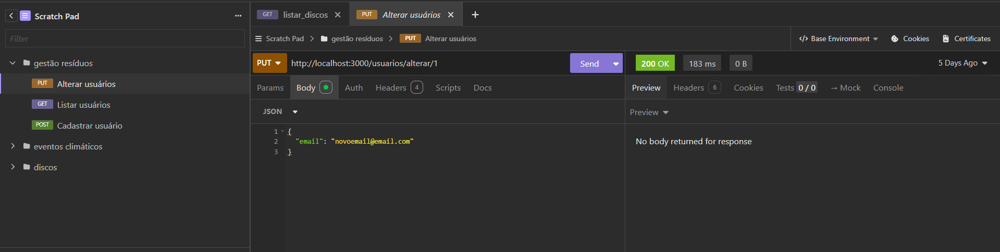

### Exclusão de usuário

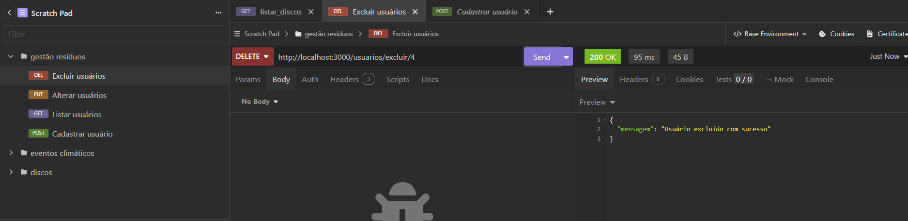

### Login

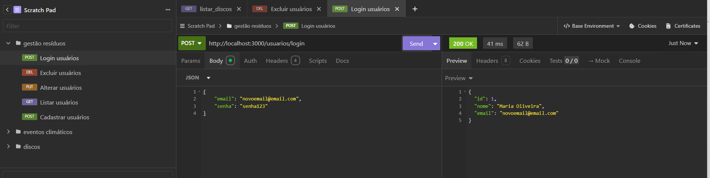

### Cadastro de ocorrência

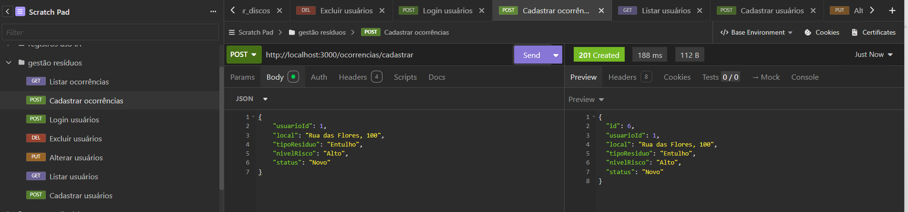

### Listagem de ocorrências

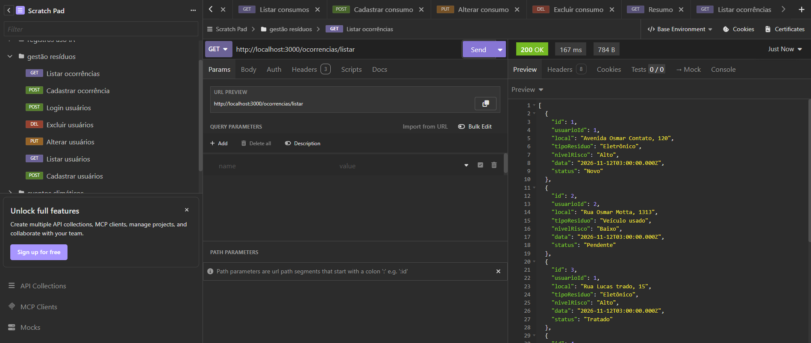

### Alteração de ocorrência

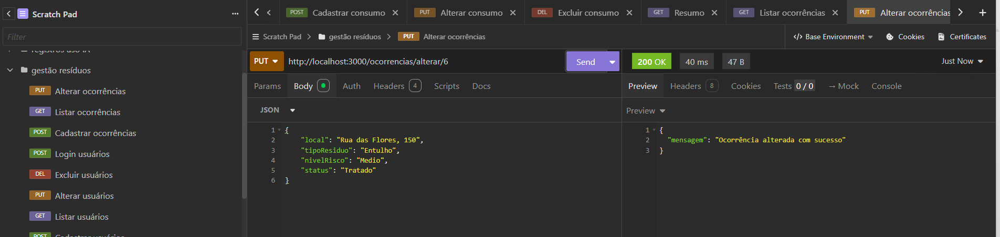

### Exclusão de ocorrência

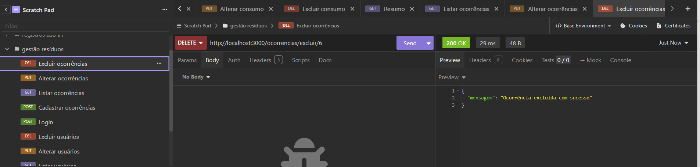

### Resumo de ocorrências tratadas

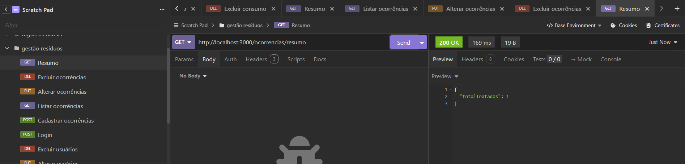
